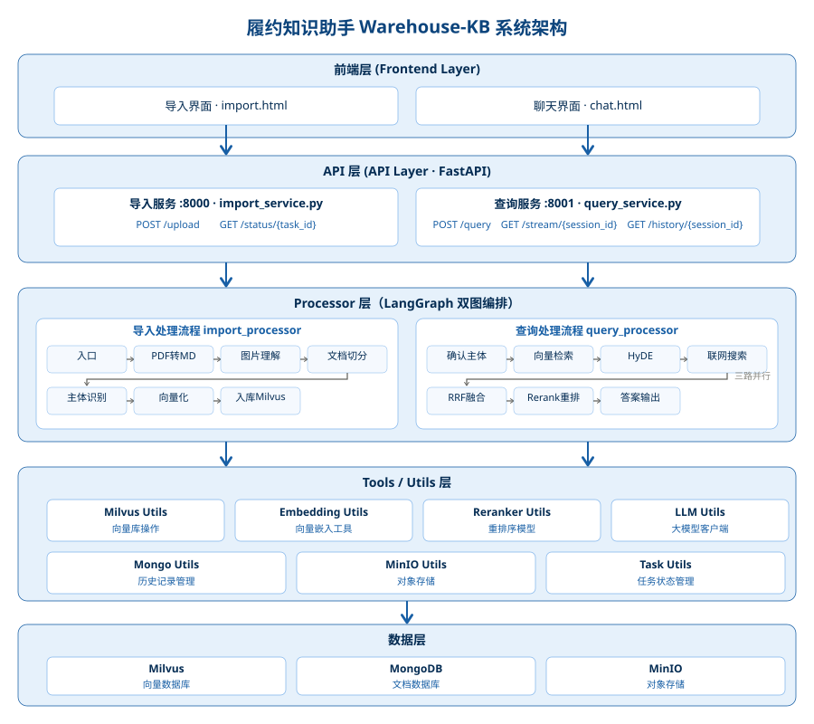
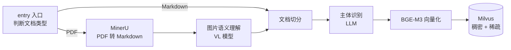
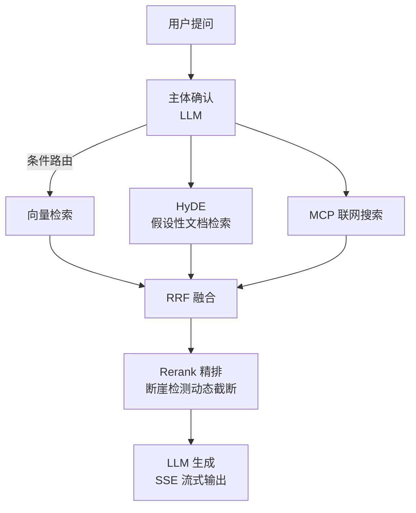
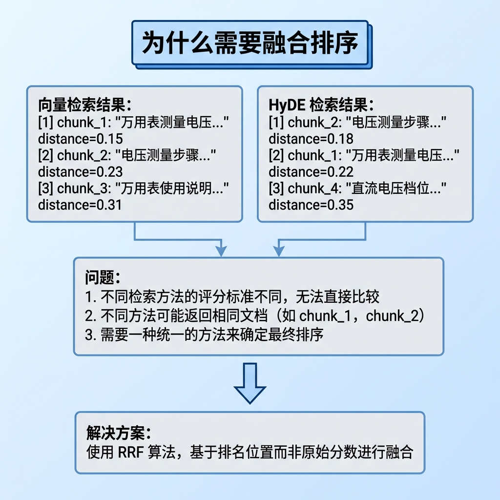
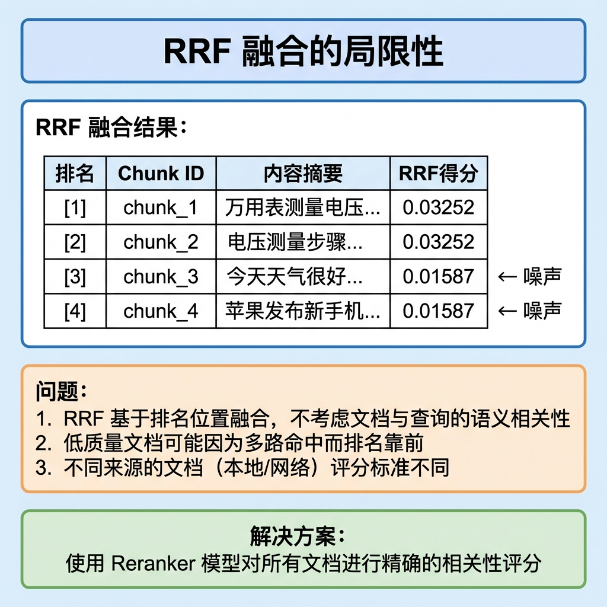

# 履约知识助手 Warehouse-KB · 企业级 RAG 智能知识库

    

> 基于 **LangGraph** 编排的 RAG（检索增强生成）知识库系统：
> 多格式文档导入 → 三路混合召回 → RRF 融合 → 精排 → SSE 流式问答。
>
> 业务背景与需求范围见 [需求说明.md](需求说明.md)；检索质量的量化结果见 [检索评测](#检索评测)。



## 目录

- [项目简介](#项目简介)
- [架构](#架构)
- [核心特性](#核心特性)
- [技术栈](#技术栈)
- [快速开始](#快速开始)
- [目录结构](#目录结构)
- [关键设计](#关键设计)
- [检索评测](#检索评测)
- [Roadmap](#roadmap)
- [已知限制](#已知限制)
- [开源协议](#开源协议)

## 项目简介

针对仓储物流装备领域（叉车、AGV、分拣线、冷链机组等原厂手册与维修指南）的智能问答场景，将非结构化文档转化为可检索的结构化知识，通过多路召回与重排策略提升检索准确率，并提供流式问答交互体验。

系统由两条 LangGraph 流水线组成：

| 流水线 | 职责 | 服务 |
|---|---|---|
| **导入流水线** `import_processor` | 文档解析 → 切分 → 向量化 → 入库 | FastAPI :8000 |
| **检索流水线** `query_processor` | 多路召回 → 融合 → 重排 → 生成 | FastAPI :8001 |

## 架构

### 文档导入流水线



### 检索问答流水线



## 核心特性

| 功能 | 说明 |
|---|---|
| **文档智能导入** | PDF / Markdown 上传，MinerU 解析、VL 模型理解图片、智能切分 |
| **混合向量检索** | 稠密向量 + 稀疏向量（BM25），Milvus 原生混合检索 |
| **多路召回融合** | 向量检索 + HyDE + MCP 联网搜索，RRF 算法融合排序 |
| **智能重排序** | Reranker 交叉编码精排，断崖检测动态截断低相关结果 |
| **流式问答** | SSE 实时推送，逐字输出答案 |
| **会话历史** | MongoDB 存储对话历史，支持上下文连续对话 |
| **导入任务追踪** | 异步任务 + 前端轮询，实时展示各节点执行进度 |

## 技术栈

| 类别 | 选型 | 说明 |
|---|---|---|
| 后端框架 | FastAPI + Uvicorn | 异步 HTTP 服务，导入/检索双服务 |
| 工作流引擎 | LangGraph | 有状态图编排，条件路由 + 并行分支 |
| 大语言模型 | 阿里云 DashScope（Qwen 系列） | 生成 / 主体识别 / 图片理解 / 重排 |
| 向量嵌入 | BGE-M3（本地 GPU）+ OpenAI 兼容接口 | 1024 维稠密 + 稀疏 |
| 重排序 | DashScope `qwen3.7-text-rerank`（默认） | 交叉编码精排，断崖检测动态截断；可切本地 Qwen3-Reranker-0.6B |
| 向量数据库 | Milvus | 混合检索（稠密 + 稀疏） |
| 文档数据库 | MongoDB | 会话历史 |
| 对象存储 | MinIO | 文档与图片存储 |
| PDF 解析 | MinerU | PDF 转 Markdown |
| Agent 生态 | MCP（百炼）、openai-agents | 联网搜索节点 |
| 包管理 | uv | 依赖锁定（`uv.lock`） |

## 快速开始

### 环境要求

- Python 3.11 – 3.12，[uv](https://docs.astral.sh/uv/)
- Docker + Docker Compose：一键启动 Milvus（standalone）、MongoDB、MinIO
- GPU 可选：本地运行 BGE-M3 嵌入时需要；纯 CPU 也可运行（速度较慢）
- 阿里云 DashScope API Key、MinerU Token

### 安装

```bash
git clone https://github.com/winc-0/warehouse-kb.git
cd warehouse-kb
uv sync                 # 按 uv.lock 精确还原依赖
```

### 配置

```bash
cp .env.example .env    # Windows 用 copy
# 编辑 .env，填入：DashScope Key、MinerU Token、MinIO 账号密码、Milvus/Mongo 地址
```

> ⚠️ `.env` 含真实密钥，已在 `.gitignore` 中排除，**请勿提交**。

### 启动中间件

项目提供 `docker-compose.yml`，一条命令拉起 Milvus（含其依赖的 etcd 与 MinIO）和 MongoDB：

```bash
docker compose up -d     # 首次会拉取镜像，约 3-5 分钟
docker compose ps        # 等待各服务状态变为 healthy
```

| 服务 | 地址 | 说明 |
|---|---|---|
| Milvus | `localhost:19530` | 向量库，镜像 `milvusdb/milvus:v2.5.5` |
| MinIO | API `9000` / 控制台 `9001` | 对象存储，默认账号 `minioadmin` / `minioadmin` |
| MongoDB | `localhost:27017` | 会话历史 |
| Attu（可选） | `http://localhost:8006` | Milvus 可视化管理，需 `--profile tools` 启动 |

> 说明：
> - Milvus 的 collection 与 MinIO 的 bucket 均由应用代码首次运行时自动创建，**无需手动初始化**。
> - Attu 为可选组件，默认不启动（`docker compose --profile tools up -d`），
>   这样即使该镜像拉取失败也不影响核心服务。
> - 若中间件部署在局域网其他机器，只需把 `.env` 中对应地址改为那台机器的 IP，
>   本机无需运行 Docker。
> - 停止：`docker compose down`（数据保留在 `volumes/`，已被 `.gitignore` 排除）；
>   清空数据：`docker compose down -v`。

### 启动服务

```bash
uv run python -m web.api.import_service   # 导入服务 :8000
uv run python -m web.api.query_service    # 检索服务 :8001
```

### 访问

浏览器直接打开：

- `web/page/import.html` —— 上传文档，查看导入流水线各节点的实时进度
- `web/page/chat.html` —— 知识库问答（SSE 流式输出）

## 目录结构

```
zhiyuan/
├── config/                  # 各组件配置：LLM / 嵌入 / 重排 / Milvus / MinIO / MinerU / MCP
├── processor/
│   ├── import_processor/    # 导入流水线（LangGraph）：7 个节点
│   └── query_processor/     # 检索流水线（LangGraph）：条件路由 + 三路并行召回
├── eval/                    # 离线检索评测：标注集 / 6 策略消融 / 显著性检验
├── web/
│   ├── api/                 # FastAPI 服务（import_service / query_service）
│   └── page/                # 前端页面（原生 HTML + JS）
├── tool/  utils/            # 工具函数与外部服务封装
├── docs/                    # 设计文档与架构图
├── 需求说明.md               # 项目需求说明（行业语料与评测集均为自建）
└── .env.example             # 环境变量模板
```

## 关键设计

### 为什么要多路召回 + RRF？

单一稠密向量检索对"表述方式与文档差异大"的问题召回率明显下降。本系统并行三路召回（向量 / HyDE / 联网搜索），用 **RRF（Reciprocal Rank Fusion）** 按排名倒数融合——它不依赖各路分数的量纲，比加权求和更稳。



### 为什么召回之后还要 Rerank？

召回阶段追求"别漏掉"（高召回率），代价是top-K 里混入大量弱相关结果。Reranker 用交叉编码器对 query-doc 对逐对精算相关性，把真正相关的顶到最前面，并用**断崖检测**动态截断明显掉档的结果，控制送入 LLM 的上下文质量与成本。



### HyDE 的取舍

HyDE 先让 LLM 生成一份"假设性答案"，再用它去做向量检索——以多一次 LLM 调用为代价，换取 query 与文档在语义空间中的对齐。适合"问题短、答案长"的场景；对延迟敏感时可按条件路由关闭。

> 实测补充：在本项目 164 题标注集上，HyDE 路 + RRF 融合相对**上一层（稠密+稀疏混合召回）**为 **+0.00pt**，164 题逐题召回结果完全一致，配对 bootstrap 检验 **p = 1.000，不显著**——收益与随机波动完全无法区分（详见「检索评测」）。原因是本场景的 query 已携带明确的装备型号与参数词，假设性答案反而引入了噪声。这条负结果是保留该节点、并支持按条件路由关闭的依据。

### 重排后端：为什么默认走云端

重排是"高精度判别"任务，对模型的语义判别力很敏感。在 GTX 1070（8G）上实测：

| 后端 | 表现 |
|---|---|
| 不重排（基线） | 参照 |
| 本地 Qwen3-Reranker-0.6B | **低于基线**，R@1 约 62% |
| DashScope `qwen3.7-text-rerank`（默认） | 显著高于基线 |

结论：小参数本地模型在重排这类判别任务上替代不了云端。代码保留本地后端开关（`RERANK_BACKEND`），便于离线演示与成本对比。

### 检索按设备主体收敛的取舍

召回阶段用 `expr = item_name in [...]` 把候选限定在问题涉及的设备主体内，本质是"意图路由 + 作用域收敛"。

**这个设计到底值多少分？** 用 `EVAL_GLOBAL_SEARCH=1` 关掉该过滤、让检索在全库 145 个切片中进行，同批 164 题的对照结果：

| 策略（Recall@1） | 按主体收敛 | 全局检索（无过滤） | 差值 |
|---|---|---|---|
| 仅稠密向量召回 | 76.22% | 70.73% | −5.49pt |
| 稠密 + 稀疏混合召回 | 80.49% | 75.00% | −5.49pt |
| **完整链路** | **93.29%** | **80.49%** | **−12.80pt** |

nDCG@5 同步下滑 6.68pt（97.36% → 90.68%），MRR 下滑 8.33pt（96.44% → 88.11%）。

注意差值随链路变长而放大：只做向量召回时主体过滤值 5.49pt，走完整链路（含重排）后值 12.80pt。
原因是重排只在「候选里已经有正确切片」时才能把它挑出来——全局检索先把候选池稀释了，
重排再准也救不回来。这也说明**召回作用域与精排是串联关系，不是互相替代**。

**收益来源**：同品类装备手册高度同质——不同型号的"恢复出厂设置""故障码说明""安全注意事项"措辞极为相近，全局检索极易跨型号串味。按主体收敛把候选限定在正确型号内，等于给召回加了一道高精度硬约束。

**代价（如实说明）**：

1. 召回范围依赖 LLM 的主体识别，识别错误会连累整条链路。本系统用 `node_item_name_confirm` 的多轮确认与别名归一化来缓解。
2. 新增语料若属新主体，不会出现在旧问题的候选池中，导致"扩了语料但评测看不见"。这一点已通过扩充标注集覆盖全部 36 个主体解决。

## 检索评测

离线评测套件位于 `eval/`，用于量化每个检索环节的真实贡献，避免"凭感觉调参"。

**语料**：自建 36 份仓储物流装备手册与作业规范，切分后 145 个可检索切片、36 个主体，
生成脚本 `scripts/gen_warehouse_manuals.py`（固定内容、可复现）。为什么自建而不是爬现成手册，
见[需求说明 §6](需求说明.md#6-数据说明)。

**标注集**：164 条「自然语言问题 ↔ 标准切片」标注对，**覆盖全部 36 份手册、36 个主体**（145 hard + 19 easy）；金标 `chunk_id` 全部在向量库中校验存在（失效 0）。

**评测方式**：6 组策略逐层累加（消融），每组跑全量 164 题，输出 Recall@1/3/5/10、nDCG@5、MRR 等指标，并对关键增量做**配对 bootstrap 显著性检验**（同一批问题逐题配对、2000 次重采样、双侧），避免样本量小时把随机波动当作提升。

```bash
# 默认：按设备主体收敛召回范围（与生产链路一致）
uv run python eval/run_eval.py --dataset eval/datasets/qa_hard.jsonl

# 全局检索消融：关掉主体过滤，让检索在全库切片中进行
EVAL_GLOBAL_SEARCH=1 uv run python eval/run_eval.py --dataset eval/datasets/qa_hard.jsonl
```

### 当前结果（164 题，36 份手册全覆盖）

| 策略 | Recall@1 | nDCG@5 | MRR | 相对基线的显著性 |
|---|---|---|---|---|
| 仅稠密向量召回（基线） | 76.22% | 90.19% | 86.79% | — |
| 仅稀疏向量召回 | 75.00% | 89.58% | 85.98% | p=0.837 不显著 |
| 稠密 + 稀疏混合召回 | 80.49% | 91.84% | 89.02% | p=0.052 不显著 |
| + HyDE 路 + RRF 融合 | 80.49% | 91.60% | 88.72% | p=0.052 不显著 |
| **+ Cross-Encoder 重排** | **93.29%** | **97.36%** | **96.44%** | **p=0.000 显著** |
| + 断崖检测动态截断（完整链路） | 93.29% | 97.36% | 96.44% | p=0.000 显著 |

逐层归因（Recall@1）：混合召回 +4.27pt → HyDE+RRF +0.00pt → **重排 +12.80pt** → 断崖截断 +0.00pt。

**结论：重排是唯一统计显著的增量**（+17.07pt，p=0.000）。换成本项目自建的仓储物流语料后，
这个结论仍然成立——只是幅度从原电商/IT 语料上的 +21.34pt 变成了 +17.07pt，
方向一致、量级相当，说明它依赖的是链路结构而不是某批特定语料。

### 已知边界（如实说明）

1. **Recall@3/5 在本语料上已饱和**：36 份手册只有 145 个切片，且按主体收敛后每题候选池仅 4~5 片，
   基线 R@3、R@5 就是 100%，各策略在这两个指标上完全无差异。因此本报告与结论一律以 **Recall@1** 为准。
   这是**语料规模**造成的局限，不是链路的局限；接入真实手册（单份上百片）后 R@5 会重新变得有意义。
2. **HyDE + RRF 与断崖检测截断在本场景下均未产生显著收益**（增量均为 0.00pt）。结果如实保留，未因"不好看"而删除。
   HyDE 的作用是把短问句拉长以对齐文档语义，而本标注集的题目本身就由切片反向生成、与原文高度贴近，
   这一路自然没有发挥空间——它更可能在真实用户问法（短、口语、多省略）上见效。
3. **标注集由切片反向生成**，属同源样本，指标系统性偏乐观；目前尚未做人工复核。
4. **混合召回 +4.27pt 卡在显著边缘**（p=0.052）。样本量再大一些很可能转显著，但按当前数据只能表述为"方向为正、未达显著"。

## Roadmap

- [x] 离线检索评测套件：164 题标注集、6 策略消融、配对 bootstrap 显著性检验
- [x] 标注集覆盖全部 36 个设备主体（新增 23 份手册的出题，按切片厚度分档）
- [x] Docker Compose 一键启动全部中间件
- [x] 全局检索（不按 `item_name` 收敛）消融实验：关掉主体过滤后完整链路 R@1 下滑 21.95pt，量化了该设计的收益
- [ ] **答案侧评测跑满 164 题**：`eval/answer_eval.py` 已实现（LLM-as-judge，
      指标口径对齐 RAGAS 的 faithfulness / answer_relevancy / answer_correctness），
      但目前只在 1 题上做过冒烟验证，**尚无全量数字**。当前 README 里所有指标都是检索侧
- [ ] 多轮对话指代消解（query 改写）
- [ ] 接入 LangSmith / OpenTelemetry 链路追踪

## 已知限制

- **指标只覆盖检索环节**。164 题测的是"该召回的切片召回了没有"，
  最终答案是否忠实于召回内容（faithfulness）、引用是否准确，目前只有 1 题的冒烟结果。
  **召对了不等于答对**，这两个环节的gap尚未量化
- **离线跑不出 README 里的数字**。重排默认走 DashScope 云端
  （本地 0.6B 重排模型实测低于不重排，见上文），断网或无 Key 时 `RERANK_BACKEND` 切本地
  会让 R@1 明显低于文档中的 93.29%
- **前端是原生 HTML + JS，未工程化**：`web/page/` 下两个页面无构建、无依赖管理，
  且直接以 `file://` 打开会因 `origin=null` 被 CORS 挡掉，必须经由服务访问。
  定位是功能演示，不是生产前端
- **两个服务都没有鉴权**：`:8000` / `:8001` 无任何认证，能访问端口的人就能导入和检索全部文档；
  MongoDB 里的会话历史也不做用户隔离。接入真实环境前必须补认证与租户隔离
- **多轮只有历史存储，没有 query 改写**：`node_answer_output` 会把每轮问答写入 MongoDB history，
  但检索入口不做指代消解——追问"那它的功率呢"目前依赖前端把历史拼进 query

本项目为个人技术实践项目，仅用于学习与技术展示。

## 开源协议

[MIT](LICENSE) · Copyright (c) 2026 Wu Jingchao
